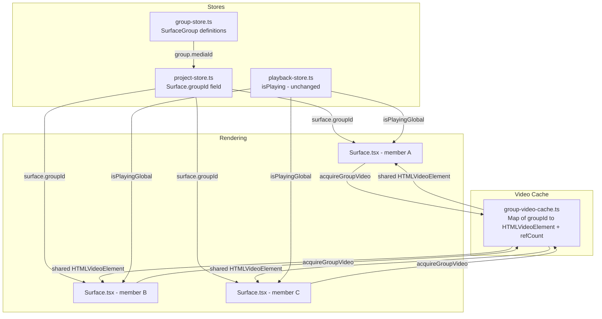
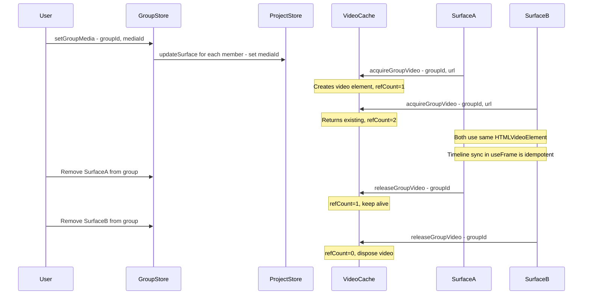

# Surface Grouping System — Implementation Plan

## Overview

Add a Surface Grouping feature that lets multiple surfaces play the same video simultaneously with synchronized playback. Groups provide shared media, shared playback, group-level opacity/blend, and visual identification via colored outlines.

**Core principle:** Surfaces in a group share a **single `HTMLVideoElement`** via a module-level cache (not in the store). The group store assigns the same `mediaId` to all members. Each `Surface.tsx` instance checks if it belongs to a group—if so, it uses the cached shared video element instead of creating its own.

---

## Architecture Diagram



---

## Data Flow: Video Sharing



---

## 1. Data Model Changes

### 1a. New interface: `SurfaceGroup` — in `src/store/group-store.ts`

```typescript
interface SurfaceGroup {
    id: string;
    name: string;
    color: string;            // Hex color for visual indicators
    mediaId: string | null;   // Shared media asset ID
    opacity: number;          // Group-level opacity multiplier (0-1)
    blendMode: BlendMode;     // Group-level blend mode
    playbackRate: number;     // Speed: 0.25 - 4.0
    loop: boolean;            // Loop video
    surfaceIds: string[];     // Ordered member surface IDs
    collapsed: boolean;       // UI state for outliner
}
```

### 1b. Surface interface change — in `src/store/project-store.ts`

Add one optional field to the existing `Surface` interface:

```typescript
interface Surface {
    // ... all existing fields unchanged ...
    groupId?: string;   // NEW: Reference to SurfaceGroup.id
}
```

This is the **only** change to project-store's data model.

---

## 2. New Files

### 2a. `src/store/group-store.ts` — Group State Management

**Pattern:** Matches `ui-store.ts` — plain Zustand, no persist (groups reference surfaces that are persisted; the group store can optionally use persist later).

```typescript
interface GroupStore {
    // State
    groups: SurfaceGroup[];
    selectedGroupId: string | null;

    // Group CRUD
    createGroup: (name: string, surfaceIds: string[]) => string;  // returns groupId
    deleteGroup: (groupId: string) => void;
    renameGroup: (groupId: string, name: string) => void;
    setGroupColor: (groupId: string, color: string) => void;
    toggleGroupCollapsed: (groupId: string) => void;

    // Member management
    addSurfaceToGroup: (groupId: string, surfaceId: string) => void;
    removeSurfaceFromGroup: (groupId: string, surfaceId: string) => void;

    // Media & playback
    setGroupMedia: (groupId: string, mediaId: string | null) => void;
    setGroupOpacity: (groupId: string, opacity: number) => void;
    setGroupBlendMode: (groupId: string, blendMode: BlendMode) => void;
    setGroupPlaybackRate: (groupId: string, rate: number) => void;
    setGroupLoop: (groupId: string, loop: boolean) => void;

    // Helpers
    getGroupForSurface: (surfaceId: string) => SurfaceGroup | undefined;
}
```

**Key action logic:**

- `createGroup`: Generates ID, assigns random color from preset palette, sets `groupId` on each surface via `useProjectStore.getState().updateSurface()`, returns new group ID.
- `deleteGroup`: Clears `groupId` from all member surfaces, removes group.
- `setGroupMedia`: Updates `group.mediaId` AND calls `updateSurface(surfaceId, { mediaId })` for ALL members — this is what makes them all point to the same media.
- `addSurfaceToGroup`: Adds surfaceId to `surfaceIds[]`, sets `surface.groupId`, sets `surface.mediaId` to `group.mediaId`.
- `removeSurfaceFromGroup`: Removes surfaceId from `surfaceIds[]`, clears `surface.groupId`. Surface keeps its current mediaId (or optionally clears it).

**Color palette:** `['#ef4444', '#f97316', '#eab308', '#22c55e', '#06b6d4', '#8b5cf6', '#ec4899']`

### 2b. `src/lib/group-video-cache.ts` — Shared Video Element Cache

**Module-level singleton** (not in a store — video elements are non-serializable DOM objects).

```typescript
interface CacheEntry {
    video: HTMLVideoElement;
    refCount: number;
    url: string;
}

// Module-level cache
const groupVideoCache = new Map<string, CacheEntry>();

export function acquireGroupVideo(groupId: string, url: string): HTMLVideoElement;
export function releaseGroupVideo(groupId: string): void;
export function getGroupVideo(groupId: string): HTMLVideoElement | null;
export function updateGroupVideoUrl(groupId: string, url: string): void;
```

**`acquireGroupVideo(groupId, url)`:**
1. If cache has entry for groupId AND url matches → increment `refCount`, return existing video
2. If cache has entry but url changed → pause old video, update src, return
3. If no entry → create `HTMLVideoElement` with same config as Surface.tsx (crossOrigin, loop, muted, playsInline, preload), set src, store with refCount=1, return

**`releaseGroupVideo(groupId)`:**
1. Decrement refCount
2. If refCount <= 0 → pause, clear src, call `.load()` to release memory, delete from Map

**`getGroupVideo(groupId)`:**
Returns the video element if it exists (for playback control from group store actions).

This approach means zero changes to how Three.js VideoTexture works — Surface.tsx just gets a different `HTMLVideoElement` reference.

### 2c. `src/hooks/useGroupVideo.ts` — React Hook for Group Video

Wraps the cache with proper React lifecycle (acquire on mount/change, release on cleanup):

```typescript
export function useGroupVideo(
    groupId: string | undefined,
    mediaUrl: string | undefined
): HTMLVideoElement | null {
    // If no groupId, return null (surface uses its own video)
    // useEffect: acquire on mount, release on cleanup
    // Handles url changes via updateGroupVideoUrl
    // Returns the shared video element
}
```

---

## 3. Modified Files

### 3a. `src/store/project-store.ts` — Minimal Change

**Line ~10-49 (Surface interface):** Add `groupId?: string` after `useComposition`.

**No other changes.** The `updateSurface` action already handles `Partial<Surface>`, so setting/clearing `groupId` works automatically.

### 3b. `src/components/canvas/Surface.tsx` — Video Element Branching

**Current flow (lines 90-186):**
```
mediaAsset → resolvedUrl → create HTMLVideoElement → setVideoElement(video)
```

**New flow:**
```
if (surface.groupId) {
    videoElement = useGroupVideo(surface.groupId, resolvedUrl)
} else {
    videoElement = existing local creation logic (unchanged)
}
```

**Specific changes:**

1. **Import** `useGroupVideo` hook and `useGroupStore`
2. **Add selector** for group data:
   ```typescript
   const group = useGroupStore(state =>
       surface.groupId ? state.groups.find(g => g.id === surface.groupId) : undefined
   );
   ```
3. **Add group video hook** (before existing video creation effect):
   ```typescript
   const groupVideoElement = useGroupVideo(surface.groupId, resolvedUrl);
   ```
4. **Modify the video creation useEffect** (lines 90-186): Wrap in condition `if (surface.groupId) return;` — skip individual video creation when grouped
5. **Modify `setVideoElement` / texture source**: Use `groupVideoElement ?? videoElement` as the effective video element
6. **Apply group opacity in useFrame** (around line 673):
   ```typescript
   const groupOpacity = group ? group.opacity : 1;
   uniforms.uOpacity.value = reactiveOpacity * groupOpacity;
   ```
7. **Apply group playback rate**: In the play/pause effect, if grouped, set `video.playbackRate = group.playbackRate`

### 3c. `src/components/panels/SurfaceOutliner.tsx` — Grouped Layer View

**Current:** Flat list of `SortableLayerRow` sorted by zIndex descending.

**New:** Two-level display with group headers:

1. **Import** `useGroupStore`
2. **Separate surfaces** into grouped and ungrouped:
   - Build ordered list: For each group (sorted by first member's zIndex), emit a `GroupHeader` row followed by indented member rows (if not collapsed). Then emit remaining ungrouped surfaces.
3. **New component: `GroupHeaderRow`:**
   - Color dot (group.color), editable name, collapse toggle, visibility toggle (toggles all members), delete group button
   - Context menu: Rename, Change Color, Set Video, Ungroup All, Delete
4. **Modify `SortableLayerRow`:**
   - If surface has groupId: show with left indent (pl-6), show small color dot matching group color
   - Context menu addition: "Remove from Group" option when grouped
5. **Context menu on ungrouped surfaces:** Add "Add to Group >" submenu listing existing groups + "New Group"
6. **Multi-select context menu:** Add "Group Selected Surfaces" option when multiple surfaces are selected

### 3d. `src/components/panels/SurfaceProperties.tsx` — Group Info Section

When a grouped surface is selected, show a collapsible "Group" section above the existing properties:

- Group name (read-only link, click to select group)
- Group color indicator
- Group opacity slider
- Group blend mode dropdown
- Group playback rate slider
- "Remove from Group" button

This section reads from `useGroupStore` using the surface's `groupId`.

### 3e. `src/components/canvas/SurfaceBorder.tsx` — Colored Group Outlines

When a surface belongs to a group, render an additional colored outline (using `group.color`) around the surface in the canvas. This provides visual identification of which surfaces belong to which group.

**Changes:**
- Import `useGroupStore`
- If surface has `groupId`, look up group color
- Render a thin colored `<Line>` border (from @react-three/drei) in the group color, slightly outside the surface corners

### 3f. `src/components/panels/LeftSidebar.tsx` — Integration

The group management is primarily done through:
1. The SurfaceOutliner (group headers inline with surfaces)
2. Context menus (right-click to group/ungroup)
3. SurfaceProperties panel (group section when grouped surface selected)

No new tab needed. The existing "Layers" tab in LeftSidebar shows the outliner which will now include group headers.

---

## 4. Integration Points Summary

| Component | What Changes | Why |
|-----------|-------------|-----|
| [`Surface`](src/components/canvas/Surface.tsx) | Video element source branching, group opacity in useFrame | Core rendering with shared video |
| [`project-store`](src/store/project-store.ts) | `groupId?: string` on Surface | Link surfaces to groups |
| [`SurfaceOutliner`](src/components/panels/SurfaceOutliner.tsx) | Group headers, indented members, context menus | Group management UI |
| [`SurfaceProperties`](src/components/panels/SurfaceProperties.tsx) | Group info section | Group property editing |
| [`SurfaceBorder`](src/components/canvas/SurfaceBorder.tsx) | Colored group outlines | Visual identification |

| New File | Purpose |
|----------|---------|
| [`group-store.ts`](src/store/group-store.ts) | Group state + CRUD actions |
| [`group-video-cache.ts`](src/lib/group-video-cache.ts) | Shared HTMLVideoElement pool |
| [`useGroupVideo.ts`](src/hooks/useGroupVideo.ts) | React hook wrapping video cache |

---

## 5. What Stays Unchanged

- **Shader pipeline**: No GLSL changes. Group opacity is applied via existing `uOpacity` uniform multiplication.
- **Timeline sync**: The existing `useFrame` sync (`videoElement.currentTime = timelineState.currentTime`) works identically — multiple surfaces setting the same video element's currentTime is idempotent.
- **Playback store**: `isPlayingGlobal` drives play/pause for all videos including shared ones.
- **LayerCompositor / composition texture**: Unaffected. `useComposition` surfaces work independently of grouping.
- **Corner pin / mesh warp / effects**: All per-surface, completely independent of grouping.
- **History/undo**: Works via existing `saveHistory()` since `groupId` is just another Surface field.

---

## 6. Edge Cases & Considerations

1. **Surface deleted while in group**: `deleteSurface` in project-store should trigger cleanup. Add a `subscribe` in group-store that watches for surface deletions and removes them from groups.

2. **Group with 0 members**: Auto-delete the group when the last member is removed.

3. **Media URL hydration for groups**: The existing blob URL hydration in Surface.tsx (lines 62-88) resolves the URL. The `useGroupVideo` hook receives the resolved URL, so it works with both blob and HTTP URLs.

4. **Output window**: Groups work identically in output window since Surface.tsx is used in both contexts.

5. **Project persistence**: `groupId` on Surface is persisted via project-store's persist middleware. The group-store should also use persist middleware to save group definitions.

6. **Drag surface between groups in outliner**: Future enhancement. Initial version uses context menu only.
